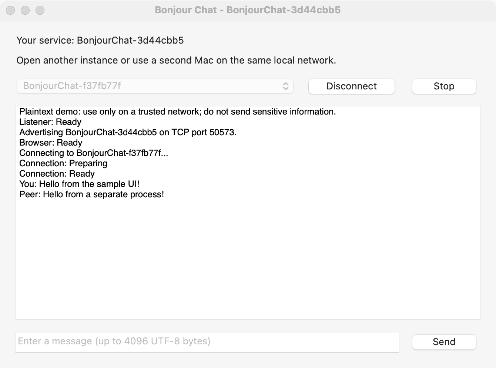

# Bonjour Chat

A small native macOS app demonstrating the Bonjour advertise/discover/connect
flow in [Advances in Networking, Part 2 (WWDC 2019)](https://developer.apple.com/videos/play/wwdc2019/713/).
Instead of a game, two instances exchange short text messages.



## Requirements and setup

- macOS 14 or later and the .NET 10 SDK.
- The `macos` workload (`dotnet workload install macos`) and its compatible
  Xcode version. See the [.NET Apple platform release notes](https://github.com/dotnet/macios/wiki/Release-notes).
- Two running instances, either on one Mac or on two Macs on the same local
  network. No server, Apple Developer account, third-party packages, or
  provisioning profile is needed for local macOS development.

From the repository root:

```sh
dotnet build BonjourChat/BonjourChat.sln
open -n BonjourChat/macOS/bin/Debug/net10.0-macos/osx-*/"Bonjour Chat.app"
open -n BonjourChat/macOS/bin/Debug/net10.0-macos/osx-*/"Bonjour Chat.app"
```

The wildcard selects the build's architecture directory (`osx-arm64` or
`osx-x64`). If you have built both architectures, replace it with the one for
your Mac. On a second Mac, build and launch its own copy of the sample.

## Try it

1. Allow **Local Network** access if macOS asks, and allow incoming connections
   if the firewall asks. Each window displays its unique `BonjourChat-...`
   service name. Advertising and browsing start automatically.
2. Select the other instance's service from the menu and click **Connect**
   in **one window only**. Wait for `Connection: Ready` in both transcripts.
   The accepting instance does not need to click Connect.
3. Enter a message and click **Send** (or press Return). Try sending in both
   directions, including non-ASCII text. `You:` indicates that TCP accepted the
   send, not an application-level acknowledgement from the peer.
4. Click **Disconnect** in either window, then select a peer and reconnect.
   **Stop** cancels the connection, browser and listener and withdraws the
   advertisement; **Start** creates them again. Quitting or closing the last
   window also stops networking.

The app intentionally supports only one connection at a time. Additional
incoming connections are rejected; disconnect before choosing another peer.
The peer menu continues to track discoveries and removals while connected.
The app hides its own service but leaves other instances on the same Mac visible.
Only the most recent 200 transcript entries are kept.

## How it works

- [`BonjourSession.cs`](macOS/BonjourSession.cs) creates TCP `NWParameters`,
  sets `IncludePeerToPeer`, and starts an `NWListener` on a system-assigned
  port. `NWAdvertiseDescriptor` publishes `_bonjourchat._tcp` in `local.`.
  The service name includes a random instance identifier.
- `NWBrowser` browses that same service type. Its result callbacks update the
  peer menu. The app retains the owned `NWBrowseResult.EndPoint` copy, not
  the callback-scoped browse result, and disposes endpoints when removed.
- Selecting a peer creates an `NWConnection` directly from its Bonjour endpoint;
  Network resolves its addresses and port. The listener accepts inbound
  `NWConnection` objects through the same connection setup code.
- All Network callbacks use `DispatchQueue.MainQueue`, serializing state changes
  with AppKit actions. Cancelled objects are disposed when cancellation completes.
  Callbacks from replaced connections/listeners/browsers are ignored.
- [`ChatProtocol.cs`](macOS/ChatProtocol.cs) uses newline-delimited UTF-8 messages,
  limited to 4096 bytes excluding the delimiter. TCP does not preserve send
  boundaries: the decoder handles partial lines, split UTF-8 characters and
  multiple lines in one receive. Blank, multiline, oversized and invalid UTF-8
  messages are rejected. An invalid incoming message closes the connection.
  EOF, including EOF in the middle of a message, is reported in the transcript.
- [`AppDelegate.cs`](macOS/AppDelegate.cs) builds the UI programmatically and
  displays browser, listener, connection and transfer errors.

## Permissions and security

`Info.plist` declares `NSLocalNetworkUsageDescription` and the exact Bonjour
service type in `NSBonjourServices`. On macOS versions with local network
privacy controls, access must be enabled in **System Settings > Privacy &
Security > Local Network**. After changing access, stop/start networking or
relaunch the app.

This development sample is **not App Sandbox-enabled**. To sandbox a derivative,
add both `com.apple.security.network.server` and
`com.apple.security.network.client` entitlements, in addition to
`com.apple.security.app-sandbox`; browsing/connecting and listening need both
network capabilities. This does not bypass local network privacy or firewall
permissions.

**This is plaintext TCP, without authentication or encryption.** Bonjour names
are not trusted identities, and any reachable peer can advertise the service
or connect to the listener. Use a trusted network and never send secrets.
A production app needs an authenticated protocol and TLS, for example using
`NWParameters.CreateSecureTcp` with proper trust/identity configuration.
The sample's message limit is not a substitute for production abuse protection.

## Troubleshooting

- **No peers:** launch a second instance with `open -n`, not just `open`.
  Confirm that both apps have local network access and are on the same LAN.
  Guest Wi-Fi/client isolation, multicast filtering, VPNs and firewalls can
  prevent Bonjour discovery or TCP connections. Try a normal shared Wi-Fi
  network. Peer-to-peer support is requested, but availability depends on the
  hardware and network; it is not a guarantee of internet-wide discovery.
- **Waiting or failed:** the transcript includes the `NWError` domain and code.
  Check permissions and network reachability. Waiting may recover when the
  network returns. After a terminal browser/listener failure, click **Start**.
  After a connection failure, select a peer and reconnect; there is no automatic
  reconnection or message retry.
- **Connection closes immediately:** connect from only one side. Simultaneous
  outbound attempts can both be rejected by this single-connection sample.
  Disconnect both sides and retry from one window.
- **A vanished peer remains briefly:** Bonjour removals are asynchronous.
  Selecting a stale service can produce a waiting/failed connection; disconnect
  and let browsing update before retrying.
- **Firewall or sandbox:** allow incoming connections for the built app. If you
  add sandboxing, check both network entitlements described above.
- **Xcode/workload mismatch:** use the Xcode version supported by the installed
  `macos` workload; do not disable SDK version checks to work around it.

## Manual verification

Use the steps above with two local instances to check discovery, bidirectional
text, disconnect/reconnect, stop/start, and removal when a peer quits. Also deny
and re-enable local network access where the OS provides that setting, and
verify that failures are visible and restarting recovers.

Repeat with two physical Macs for cross-device discovery, firewall/privacy
prompts, and network loss/recovery. Two instances on one Mac cannot establish
that these device/network-dependent cases work in your environment.
